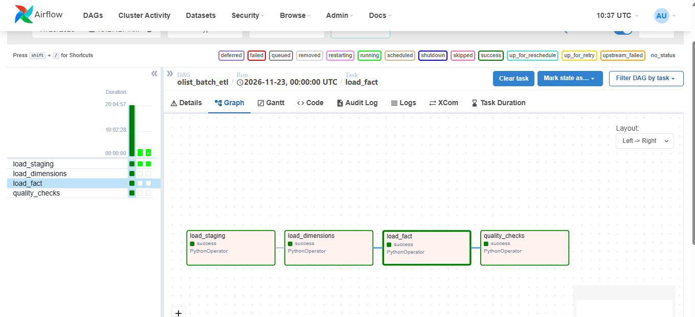
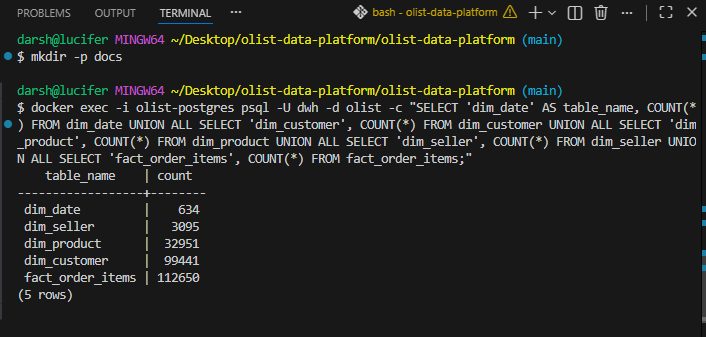
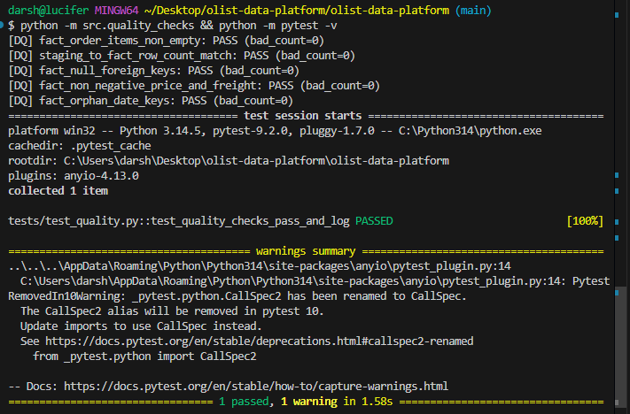
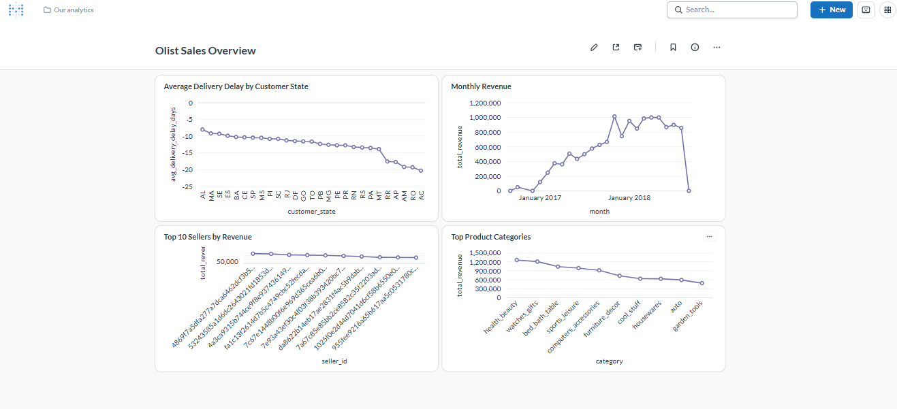
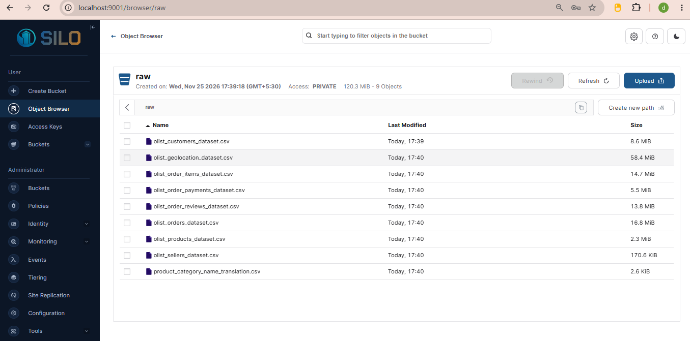
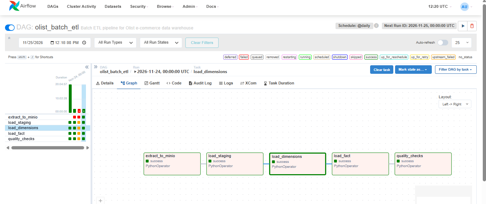

# Olist E-Commerce Batch ETL & Data Warehouse

An end-to-end batch ETL and data warehouse pipeline built on the **Olist Brazilian E-Commerce** dataset (~100k orders across 9 CSV files), using **Python (`pandas`)**, **SQL**, **PostgreSQL**, **Docker Compose**, and **Apache Airflow**.

## Architecture & Data Flow

1. **Extract & Stage (`src/load_staging.py`):** Reads raw Olist CSVs from `data/raw/` and bulk-loads them into PostgreSQL staging tables (`stg_*`).
2. **Warehouse Schema (`sql/01_schema.sql`):** Models a **star schema** in PostgreSQL (`olist` database):
   - **Fact table:** `fact_order_items` — **grain:** one row per order item (`order_id`, `order_item_id`).
   - **Dimension tables:** `dim_date`, `dim_customer`, `dim_product` (with English category translation), and `dim_seller`.
3. **Transform & Load (`sql/02_load_dims.sql`, `sql/03_load_fact.sql`):** Populates dimensions and fact records using `ON CONFLICT` upserts so reruns are **idempotent** (rerunning adds 0 duplicate rows).
4. **Data Quality & Testing (`src/quality_checks.py`, `tests/test_quality.py`):** Validates non-empty fact data, staging-to-fact row count parity, non-null keys, non-negative prices/freight, and referential integrity (`dim_date`), logging every run to `dq_results`.
5. **Orchestration (`dags/olist_etl_dag.py`):** Daily Airflow DAG (`@daily`, `catchup=False`, `retries=2`) running `load_staging >> load_dimensions >> load_fact >> quality_checks`.

## Tech Stack

- **Language & Data:** Python, `pandas`, SQLAlchemy, `psycopg2`
- **Database / Warehouse:** PostgreSQL 16
- **Orchestration:** Apache Airflow 2.9.3
- **Containerization & Testing:** Docker, Docker Compose, `pytest`, Git & GitHub

## How to Run Locally

1. Place the 9 Olist CSV files inside `data/raw/`.
2. Install local Python dependencies: `python -m pip install -r requirements.txt`
3. Start PostgreSQL and Airflow: `docker compose up -d`
4. Open Airflow at `http://localhost:8080` (`admin` / `admin`) and trigger `olist_batch_etl`.

## Proof & Screenshots

### 1. Airflow Pipeline Run (`olist_batch_etl`)

### 2. Warehouse Star Schema Row Counts

### 3. Automated Data Quality Checks & Pytest

### 4. Metabase Sales Overview Dashboard

### 5. MinIO Raw Data Lake Layer (`s3://raw`)
Added S3-compatible object storage via MinIO (`http://localhost:9001`) as the landing zone for all 9 raw Olist CSV datasets (`extract_to_minio` task), from which `load_staging` ingests into PostgreSQL.

